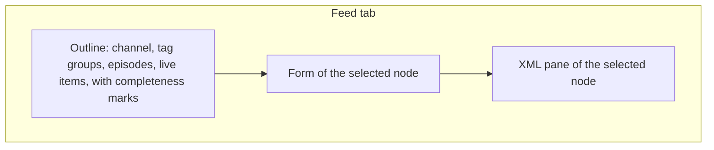
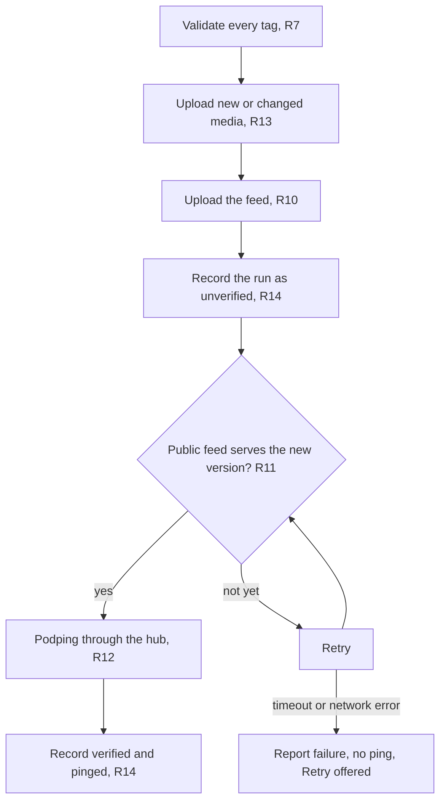
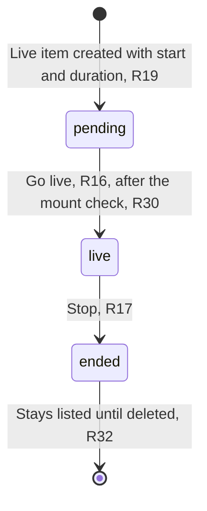
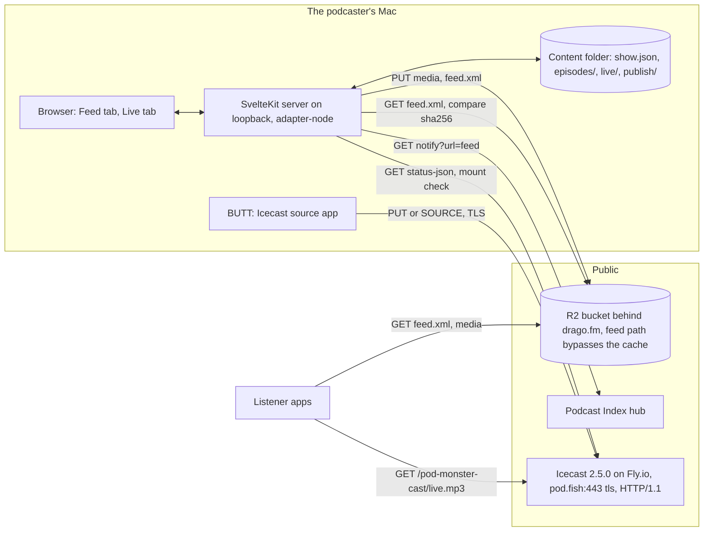
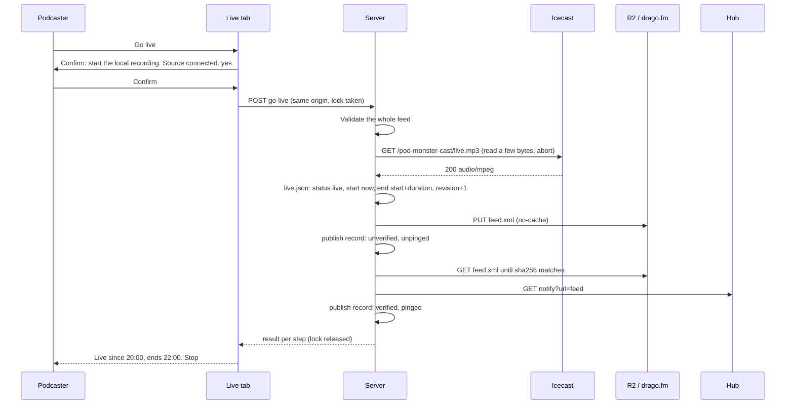

# Feed Editor, Publisher, and Go Live - Plan

**Target repo:** pod-fish. Every path below is relative to its root. The show's content folder is the `pod-monster-cast/` folder inside a separate git repo, `drago-fm`, which the app reaches through an environment variable (R1); the store's shape (`show.json`, `episodes/`, `live/`, `publish/`) sits inside that show folder, so the repo can hold another show as a sibling folder.

## Goal Capsule

- **Objective:** The podcaster publishes one show's feed, with every `podcast:` tag, to drago.fm from a web app on their Mac, and goes live on Friday 2026-11-06 with one button, so that listeners hear the stream at pod.fish through the feed.
- **Means:** A SvelteKit app on the Mac with a Feed tab and a Live tab (KTD1), a content folder of JSON files as the record (KTD4), feedsmith generation with the live item's RSS children inserted by the app (KTD5), static publish to a Cloudflare R2 bucket (KTD6), a pluggable podping sender with the Podcast Index hub first (KTD7), and Icecast 2.5.0 on Fly.io (KTD8).
- **Authority hierarchy:** The Product Contract's requirements win on behavior. Key Technical Decisions win on mechanism within their cited requirements. Implementation units override neither.
- **Execution profile:** One developer with agents, on the Mac, under the gates of U1. The Friday path (Phase A) must be green by Thursday 2026-11-05; Phase B lands after the show.
- **Stop conditions:** Tuesday 2026-11-03 by 18:00: the drago.fm nameserver change and the Fly certificate request are in (Dependencies). Wednesday 2026-11-04 is the go/no-go for the stream host (the two-hour soak test of U5) and for the hub ping (the Wednesday test of U4). Thursday 2026-11-05 is the dress rehearsal of U7. A red check on any day switches to its named fallback instead of continuing.
- **Open blockers:** None for planning. The podcaster's own actions before Friday are listed under Dependencies / Assumptions.
- **Who finishes the remaining work:** `ce-work` builds the units in `pod-fish`. The podcaster does the account, DNS, and email steps, and runs the rehearsal.

---

## Product Contract

**Product Contract preservation:** changed, with each change confirmed in the plan scope check or added by a review pass and named here: R3 excludes media from the content folder's git history; R16 was split, its mount check moved to R30, and it now writes a planned end; R19 takes a duration; R28 (Retry keeps the times and repeats the failed step) and R29 (published state beside local state) were added, and R28 no longer offers a ping before the public feed is confirmed; R30 (the mount check), R31 (the app answers only its own page on the Mac), and R32 (an ended live item never returns to live, and can be deleted) were added; F4 and AE15 and AE16 were reworded to match, F4 now says "publish record" for the file the Planning Contract names so, and F4 now rotates the credentials the lost Mac holds before it restores (confirmed in the review walkthrough). Dependencies and Sources were updated with the research results. Everything else is unchanged.

### Summary

A web app on the podcaster's Mac edits one show's feed with every `podcast:` tag in an outline-beside-detail editor with a live XML pane. It publishes the feed and its media as static files to a Cloudflare R2 bucket behind drago.fm, and sends a podping after each publish. A Live tab goes live and stops with one button each. The repo also stands up the Icecast server at pod.fish, so that the show streams on Friday 2026-11-06.

### Problem Frame

The podcaster has an episode outline and one failed recording. The second attempt is a live show on Friday 2026-11-06. After that the show has a weekly episode and a live show every Friday. No feed exists, and drago.fm and pod.fish are parked at the registrar. A hosted service owns the feed and charges per show. podsovereign, the closest self-hosted tool, serves the feed and the media from its own server, so it needs a public host and Postgres, it carries multi-user machinery, and it does not stream. The podcaster wants to own the feed, support every tag in the namespace, run the live process from one place, host the show as cheaply as anybody else, and build the tool under the gates their other repos use.

### Key Decisions

- KD1. **Build the app. podsovereign stays a reference** for its tag forms and its live item status model. (session-settled: user-approved, chosen over running podsovereign: it hosts rather than publishes, carries multi-user machinery, and does not stream.) Governs R1, R10.
- KD2. **One plan for the feed editor, the publisher, and the Friday slice of the Live tab.** (session-settled: user-directed, chosen over the feed editor alone and over the whole live page in one plan: the live show on Friday needs go live and stop, and the chat client is the piece that risks Friday.) Governs R15, R16, R17, R18, R19, R28, R29, R30, R32.
- KD3. **The record of the show is a folder of files outside the app repo**, the `drago-fm` repo, which the app reads and writes in a shape the app defines. (session-settled: user-approved, chosen over a local database and over the published feed as the record: recoverable, diffable, testable in the gate, and it keeps the show out of a public repo.) Governs R1, R3, R9, R14.
- KD4. **Publish writes static files to a configurable object store, Cloudflare R2 first.** (session-settled: user-directed, chosen over a deployed server and over a tunnel to the Mac: nothing to keep alive, and the target is configuration.) Governs R2, R10, R11, R13.
- KD5. **Every configuration value comes from an environment variable, and the repo is public from the first commit.** The podcaster set this; no alternative was weighed. Governs R2, R25, R27.
- KD6. **The podping goes through the Podcast Index hub.** (session-settled: user-directed, chosen over a Hive account and over podping.cloud: no credential to request before Friday.) Governs R12.
- KD7. **The stream server is a unit of this plan.** (session-settled: user-directed, chosen over a by-hand setup: Friday needs it, and the Live tab reads its status.) Governs R20, R21, R22.
- KD8. **The source is an Icecast source app on the Mac, so the server is Icecast.** (session-settled: user-directed, chosen over an RTMP encoder with an HLS repackager: the simplest server, and the continuous format Pod Monster plays.) Governs R20, R21.
- KD9. **The Feed tab is an outline beside a detail form, with an always-on XML pane.** (session-settled: user-directed, chosen over one long form with a map and over a card board, and the pane chosen over a preview tab and over a toggle.) Governs R5, R6.
- KD10. **The full gate runs at commit on main only.** (session-settled: user-directed, chosen over a light commit with the full gate at push to main, and over the full gate on every branch.) Governs R24.
- KD11. **The Live tab status shows two facts:** the live item's state in the published feed, and whether the stream server has a source. The podcaster accepted this inclusion. Governs R15, R29.

<!-- ce-section: work-relationships -->
### How This Work Fits Together

This plan covers one area: the feed editor, the publisher, the Friday slice of the Live tab, and the stream server. The breakdown below is the current understanding, not a committed roadmap. A later plan may revise, split, merge, or discard it.

- The rest of the Live tab
  - The chat room display in the Live tab. Depends on this plan's Live tab. Still to decide: an own chat client or an embedded one.
  - A podping with the `live` and `liveEnd` reasons through podping.cloud. Depends on R12 and on the token the podcaster requested on 2026-11-03; the sender of KTD7 already has the seam.
  - Managing the stream server from the app. Depends on R20 and R22.
  - Turning an ended live show into an episode from the local recording. Depends on R8 and R17.
- Content and growth
  - Importing an existing feed. Can proceed independently of this plan.
  - Editing from more than one machine. Depends on the content repo of KD3.

### Actors

- A1. The podcaster: one person on a Mac, who edits the show, publishes, and goes live.
- A2. The app: the web app on the Mac, the only writer of the content folder and the only publisher.
- A3. The object store and CDN: a Cloudflare R2 bucket behind drago.fm that serves the feed and the media.
- A4. The stream server: an Icecast server at pod.fish that takes the source from the Mac and serves the mount.
- A5. The Podcast Index hub: the relay that writes the podping to Hive on the podcaster's behalf.
- A6. Listener apps: Pod Monster and other Podcasting 2.0 apps that read the feed and play the episode or the stream.

### Requirements

**Show content and configuration**

- R1. The app manages one show whose record is a folder outside the app repo, at the path an environment variable names.
- R2. The app reads every value that differs between installs from an environment variable, and the repo commits `.env.example` with a placeholder and a one-line comment per variable.
- R3. The app defines the shape of the content folder, creates that shape in an empty folder on first run with a `.gitignore` that keeps media out of the folder's git history, and writes nowhere but the content folder and the publish target.
- R31. The app accepts a request that changes the show only from its own page on this Mac: it listens on the loopback address and rejects any other origin or host.

**Feed editor**

- R4. The editor offers every tag of the `podcast:` namespace in the spec's current list (31 active tags with their child tags) at every level the spec allows, plus the RSS and iTunes elements a podcast feed needs.
- R5. The Feed tab shows an outline of the whole feed (the channel, its tag groups, each episode, each live item) with a completeness mark per node, beside the form of the selected node.
- R6. A third pane shows the XML that the selected node will publish, updates as the podcaster edits, and shows the whole feed when the channel is selected.
- R7. The editor validates each tag against the spec's rules for it, names the node and the field of every failure, and publish refuses the feed until no failure remains.
- R8. An episode's audio and every file a tag points at (chapters, transcript, images, alternate enclosures) are added from the Mac, stored in the content folder, and described in the feed by the app (length, type, duration).
- R9. An episode or live item marked draft stays in the content folder and is excluded from the published feed.



**Publish**

- R10. Publish generates the feed from the content folder, uploads new or changed files and the feed to the object store, and makes the feed reachable at the public feed URL.
- R11. Publish fetches the public feed URL and confirms that it serves the new version before it sends the podping.
- R12. Publish sends a podping for the public feed URL through the Podcast Index hub after R11 passes, and shows the result with its reason.
- R13. Publish uploads media before the feed and leaves the public feed unchanged when any upload fails, so a half publish never shows.
- R14. Publish records what it did (the files uploaded, the feed version, the ping result, the time) in the content folder.



**Live tab**

- R15. The Live tab shows the live item's state as published (pending, live, ended) and whether the stream server has a source connected.
- R16. Go live first shows a confirmation that reminds the podcaster to start the local recording; on confirm it sets the live item's status to live with the start time now and the end at start plus the planned duration, publishes, and pings.
- R17. Stop sets the live item's status to ended with the end time now, publishes, and pings, in one press with no confirmation.
- R18. Go live and Stop are disabled while a publish is in flight, and Go live is disabled while the feed has no live item.
- R19. When the feed has no live item, the Live tab creates one from the configured stream settings (mount URL and content type) and a start time and a duration the podcaster enters, two hours by default.
- R28. A failed Go live or Stop keeps the start or end time it set and offers Retry, which repeats the failed step onward (publish again, or verify again) without resetting that time, and never pings a feed that R11 has not confirmed.
- R29. The Live tab shows the published state of the live item beside its local state, with the count of unpublished changes, so a failed step is visible.
- R30. Go live checks that the mount answers with audio before it changes the live item, and stops with a message that names the mount when it does not.
- R32. An ended live item stays listed until the podcaster deletes it and never returns to live; the next show gets a new live item.



**Stream server**

- R20. An Icecast server at a pod.fish name, over HTTPS, accepts a source from an Icecast source app on the Mac and serves the mount to listeners; its container and deploy definition live in the repo, and its passwords come from environment variables.
- R21. The mount's content type is the type the live item's enclosure declares (MP3 as `audio/mpeg` by default), so apps that route by type play it.
- R22. The app reads the stream server's status for R15 without exposing the admin password to the browser.

**Repo and gates**

- R23. The repo uses the tooling conventions of `podmonster-dot-app` and `pod-monster-native`: a formatter, a type-aware linter that forbids `as`, `!`, and loose equality in production code, a type check, an unused-code check, unit tests, and conventional commits enforced at commit-msg.
- R24. A pre-commit hook runs the full gate (format check, lint, type check, unused-code check, tests, secret scan) when the branch is main, and only format, lint, and the secret scan on staged files on any other branch; there is no pre-push gate.
- R25. The secret scan runs on every commit, including the commit message, and the repo commits no `.env` file other than `.env.example` and a test env of fake values.
- R26. The tests generate a feed from a fixture content folder and validate it against the namespace rules, with no network.
- R27. `AGENTS.md` carries the open-source and secrets rules and the gate commands.

### Key Flows

- F1. First run
  - **Trigger:** The podcaster starts the app with a `.env` that names an empty content folder.
  - **Actors:** A1, A2
  - **Steps:** The app creates the folder shape. The Feed tab opens on the channel node with every channel tag listed and unmarked. The podcaster fills the channel basics and the tags they want. The XML pane shows the channel.
  - **Outcome:** A valid, unpublished channel in the content folder.
  - **Covered by:** R1, R3, R4, R5, R6
- F2. Publish an episode
  - **Trigger:** The podcaster adds an episode with its audio and presses Publish.
  - **Actors:** A1, A2, A3, A5, A6
  - **Steps:** Validation runs. The app stores the audio and derives the enclosure facts. Publish uploads the media, then the feed, and records the run. Publish fetches the public feed and checks the version. Publish pings and updates the record.
  - **Outcome:** The episode plays in Pod Monster from drago.fm.
  - **Covered by:** R7, R8, R10, R11, R12, R13, R14
- F3. Go live on Friday
  - **Trigger:** The podcaster opens the Live tab before the show.
  - **Actors:** A1, A2, A3, A4, A5, A6
  - **Steps:** The Live tab validates the feed, shows the live item's local and published state, and shows the source status. The podcaster starts the source app and sees the source connected. The podcaster presses Go live, and the confirmation reminds them to start the local recording. On confirm the app checks the mount, sets the status to live with the planned end, publishes, verifies, and pings. Listener apps show the show as live and play the mount. After the show, Stop sets the status to ended, publishes, and pings.
  - **Outcome:** Listeners heard the show through the feed, and the feed shows the item ended.
  - **Covered by:** R15, R16, R17, R18, R19, R20, R21, R22, R28, R29, R30, R32
- F4. Recover on a new Mac
  - **Trigger:** The Mac is lost.
  - **Actors:** A1, A2
  - **Steps:** Clone the app repo and the content repo. Revoke the bucket token and issue a new one with the same one-bucket scope, rotate the Icecast source and admin passwords and enter the new source password in BUTT, and request a new podping.cloud token when one was issued, because the lost Mac still holds the old values. Write `.env` from `.env.example` with the new values. Restore the media from the bucket with the keys in the publish record. Start the app and publish.
  - **Outcome:** The public feed is unchanged and the app is back.
  - **Covered by:** R1, R2, R3, R14

### Acceptance Examples

- AE1. Ping waits for the public feed
  - **Covers R11, R12.**
  - **Given** a publish uploaded a new feed and the public URL still serves the old copy,
  - **When** the app fetches the public feed URL and the content does not match,
  - **Then** it retries and sends no ping until the content matches; after a timeout it reports failure with the reason, sends no ping, and offers Retry.
- AE2. A failed upload leaves the public feed unchanged
  - **Covers R13.**
  - **Given** an episode's audio upload fails,
  - **When** publish runs,
  - **Then** the feed is not uploaded, the public feed is the previous version, and the UI names the failed file.
- AE3. A draft is excluded
  - **Covers R9.**
  - **Given** an episode marked draft,
  - **When** publish runs,
  - **Then** the generated feed has no item for it, and the XML pane of the channel shows no such item.
- AE4. An invalid tag blocks publish
  - **Covers R7.**
  - **Given** an episode whose `podcast:value` recipient has no `split`,
  - **When** the podcaster presses Publish,
  - **Then** publish refuses, and the message names the episode and the field.
- AE5. Go live with no live item
  - **Covers R18, R19.**
  - **Given** the feed has no live item,
  - **When** the Live tab opens,
  - **Then** Go live is disabled and the tab offers to create a live item from the stream settings with a start time and a duration; after creation Go live is enabled.
- AE6. The go-live sequence
  - **Covers R16, R30.**
  - **Given** a live item with status pending, a two-hour duration, and a mount that serves audio,
  - **When** the podcaster presses Go live and confirms,
  - **Then** the status is live, the start time is now, the end is two hours later, publish runs, and the ping result shows.
- AE7. Stop
  - **Covers R17.**
  - **Given** a live item with status live,
  - **When** the podcaster presses Stop,
  - **Then** with no confirmation the status is ended, the end time is now, publish runs, and the ping result shows.
- AE8. Controls during publish
  - **Covers R18.**
  - **Given** a publish is in flight,
  - **When** the podcaster presses Go live or Stop, in this tab or in a second tab,
  - **Then** nothing happens, both controls show disabled, and a second tab's request is refused until the publish ends.
- AE9. The gate on main and on a branch
  - **Covers R24.**
  - **Given** a commit on main, or a merge into main,
  - **When** the hooks run,
  - **Then** the full gate runs and a failing test blocks the commit or the merge; on a branch, only format, lint, and the secret scan run on the staged files.
- AE10. A secret is blocked
  - **Covers R25.**
  - **Given** a staged file with a string shaped like an access key, or a commit message that holds one,
  - **When** the hooks run on any branch,
  - **Then** the commit is blocked and the message names the file or says the commit message.
- AE11. Unchanged media is not re-uploaded
  - **Covers R10.**
  - **Given** a publish where only the channel description changed,
  - **When** publish runs,
  - **Then** no media file is uploaded and the feed is.
- AE12. The mount type matches the enclosure
  - **Covers R21.**
  - **Given** the Icecast mount streams MP3,
  - **When** the live item is created,
  - **Then** its enclosure type is `audio/mpeg`, and Pod Monster plays the mount.
- AE13. A dead mount stops Go live
  - **Covers R30.**
  - **Given** a live item with status pending and a mount that answers 404 or a non-audio content type,
  - **When** the podcaster presses Go live and confirms,
  - **Then** the live item is unchanged, nothing is published, and the message names the mount URL and the answer it gave.
- AE14. Retry after a failed Stop
  - **Covers R28, R29.**
  - **Given** Stop set the end time and the feed upload failed,
  - **When** the podcaster presses Retry and chooses publish again,
  - **Then** publish, verify, and ping run with the same end time, and the Live tab shows the published state as live until the publish succeeds.
- AE15. A request from another origin or host is refused
  - **Covers R31.**
  - **Given** the app runs on the Mac,
  - **When** a request to the publish or go-live route arrives with another site's origin, or any request arrives with a host that is not the loopback address,
  - **Then** the app answers with a refusal and changes nothing.
- AE16. An ended item stays ended
  - **Covers R32.**
  - **Given** last week's live item is ended and this week's is pending,
  - **When** the Live tab opens,
  - **Then** Go live acts on the pending item, the ended item is listed with only a delete control, and no path sets it back to live.

### Success Criteria

- Primary: on Friday 2026-11-06 the live show reaches listeners through the feed. Pod Monster shows the show as live from the feed at drago.fm and plays the pod.fish mount.
- A published episode with audio uploaded by the app plays in Pod Monster from drago.fm, with chapters and transcript when set.
- The published feed passes a general feed validator (Cast Feed Validator or Apple's).
- The gate passes on the scaffold commit and on every commit to main after it.
- The monthly cost of the bucket and the stream server together is no more than a low-cost podcast host charges for one show.

### Scope Boundaries

**Deferred for later**

- The chat room display in the Live tab.
- A podping with the `live` and `liveEnd` reasons through podping.cloud or a Hive account.
- Managing the stream server from the app.
- Turning an ended live show into an episode from the local recording.
- Importing an existing feed.
- Editing from more than one machine.

**Deferred to Follow-Up Work**

- Multipart upload for media over 5 GiB; a single PUT covers every podcast file (KTD6).
- A silent fallback mount on Icecast, so a source drop does not close listener connections.
- The podping.cloud sender: its implementation behind the notifier interface, and its `live` and `liveEnd` wiring, the day the token arrives (KTD7 leaves the seam; U4 builds the hub sender only).
- Deleting a retracted episode's objects from the bucket from the app; until then the runbook names the manual delete.
- Perfectionist import and object sorting in ESLint; a new dependency the site repo does not carry.
- A private-values guard script with an image allowlist (a screenshot can leak an env file), ported from the app repo's guard pattern; until then the gitleaks rules of KTD2 cover the private strings.

**Outside this product's identity**

- Several shows, user accounts, or teams.
- Media hosting as a service, listener stats, transcription, media processing, and website rebuild hooks.
- Serving the feed from the Mac through a tunnel.
- Hosting a chat room.
- Changes to Pod Monster or any other listener app.

### Dependencies / Assumptions

- **Tuesday 2026-11-03 (done):** the drago.fm and pod.fish nameservers moved from Hover to Cloudflare, and the podping token email went out. **Wednesday 2026-11-04 morning:** the Fly app is created, its shared IPv4 and its IPv6 allocated, the pod.fish A and AAAA records added in Cloudflare DNS with the proxy off (DNS only, TTL Auto, which is 300 seconds), and the certificate requested with `fly certs add pod.fish` plus the `_acme-challenge` CNAME that `fly certs setup pod.fish` prints, because the DNS-01 challenge is the one Fly offers before any machine runs; the records stay DNS only, because a proxied record would put Cloudflare's HTTP proxy in the stream path. If the drago.fm zone is not Active by Wednesday noon, Friday's feed is served from the bucket's `r2.dev` URL for the first show and the podcaster accepts a feed URL change after it, or the show date moves.
- The public feed URL is `https://drago.fm/pod-monster-cast/feed.xml`; every object of this show sits under the `pod-monster-cast/` prefix in the bucket (KTD6).
- A Cloudflare account with R2, the bucket with the custom domain attached, a Cache Rule that bypasses the cache for the feed path (`/pod-monster-cast/feed.xml`), and an R2 API token scoped to that one bucket with object read and write only (never an account token); the CORS policy allows `GET` and `HEAD` from any origin and nothing else.
- A Fly.io account with `flyctl`; the machine always on; the source and admin passwords generated as 32-byte hex, kept in the password manager and in Fly secrets, with the source password also in BUTT's settings on the Mac, never in the app's env or the repo.
- BUTT on the Mac as the primary source app (documented TLS and a SOURCE or PUT choice), set to MP3. Audio Hijack and Ladiocast are unverified for TLS.
- `gitleaks` installed with Homebrew on the Mac that commits; the gate fails closed when it is missing.
- The public feed carries at least one episode (a short trailer, placed by hand on Wednesday) before Pod Monster adds it, because Pod Monster's crawler never completes a crawl of a feed with no episode and keeps such a feed in backoff.
- The feed is added to Podcast Index on Wednesday right after the first verified publish and before the hub test, because a hub call for an unknown feed refreshes nothing.
- The podping.cloud token was requested by email on 2026-11-03; its arrival date is unknown, so the Friday path does not depend on it.
- The Podcast Index hub call (`GET https://hub.podcastindex.org/pubnotify?url=<feed>`) is a re-fetch request with no `reason` parameter; whether it also writes a podping is tested on Wednesday (Open Questions). Pod Monster shows the live banner on its next crawl in either case and sends its push only on the `live` reason; the channel's `ttl` of 5 keeps that crawl on Pod Monster's five-minute floor (KTD5).
- feedsmith 3.0.0 generates every `podcast:` tag, including a live item's namespace children; the app inserts the live item's five RSS children itself (KTD5).
- Railway cannot host the stream: its HTTP proxy closes a request after 15 minutes and its TCP proxy carries no TLS.
- The show is one show, and the content folder is the `pod-monster-cast/` folder of the `drago-fm` repo, which the podcaster backs up as a private git repo; media lives in that folder but outside its git history and is recoverable from the bucket.
- The Mac keeps its clock automatic and does not sleep during the show (`caffeinate -i`), because a future `start` reads as pending and a sleeping Mac stops BUTT.
- The license is the podcaster's choice before the repo is pushed public. It does not change the plan.

### Sources / Research

- The Podcasting 2.0 namespace: https://podcasting2.org/docs/podcast-namespace lists 32 tags, 31 active and `images` deprecated. The spec source and `example.xml` are at https://github.com/Podcastindex-org/podcast-namespace; its `podcast.xsd` (root and `docs/schema/`) declares 11 of the 31 tags, no `liveItem`, and no RSS root, so it cannot validate a feed and the plan runs no XSD step.
- The tag matrix in `pod-monster-native/docs/feature-tracker.md` (the Summary line near line 2140 and the rows after it) names the same 31 tags with the level of each.
- podsovereign, https://github.com/rgblack316/podsovereign, README and ROADMAP read on 2026-11-02: the tag forms, the live item status model (pending, live, ended through a status call), and the hub notify URL.
- feedsmith 3.0.0, `pod-monster-native/node_modules/feedsmith`: `dist/namespaces/podcast/common/types.d.ts` (the generate input types), `dist/namespaces/podcast/generate/utils.js` (the live item generator emits the namespace children and the `status`, `start`, `end` attributes, not the RSS children), `dist/common/config.js` (`suppressEmptyNode: true`, so a child-less element is self-closing), `package.json` `exports` (only the root entry, so there is no object-stage hook), README (`generateRssFeed`).
- Podping: the podping.cloud README at https://github.com/Podcastindex-org/podping.cloud (token in the `Authorization` header, `GET /?url=&reason=&medium=`, 200 means queued); the hivewriter README at https://github.com/Podcastindex-org/podping-hivewriter (reasons `update`, `live`, `liveEnd`); the token channel in the Podcasting 2.0 episode 274 show notes of 2026-10-09 (email podping@podcastindex.org; open registration announced as coming). The hub endpoint answered a probe on 2026-11-03 with 403 without an identifying User-Agent and 400 without a feed URL.
- Cloudflare R2: https://developers.cloudflare.com/r2/ (S3 API, Range support, 5 GiB per single PUT, custom domains, `r2.dev` for development only, no public listing on custom domains) and https://developers.cloudflare.com/cache/concepts/default-cache-behavior/ (XML is not cached by default, mp3 is; origin `Cache-Control` is honored).
- Icecast: https://icecast.org/news/end-of-support-2_4_4/ (2.4.4 support ends 2026-12-31; 2.5.0 released 2025-12-31 and reads 2.4 config), https://icecast.org/docs/ (mounts, source auth, `/status-json.xsl` and its deprecation in 2.5, HTTP PUT since 2.4.0, chunked PUT only in 2.5).
- Fly.io: https://fly.io/docs/networking/services/ (the `tls` handler terminates TLS and forwards TCP; `tls_options.alpn` with no stated default; Fly manages certificates for custom domains; DNS-01 through an `_acme-challenge` record). Railway: https://docs.railway.com/networking/public-networking/specs-and-limits (15-minute request cap) and https://docs.railway.com/networking/tcp-proxy.
- SvelteKit: https://svelte.dev/docs/kit/adapter-node (`HOST`, `ORIGIN`, `BODY_SIZE_LIMIT`, `--env-file`), https://svelte.dev/docs/kit/environment-variables (`$env/*` deprecated in SvelteKit 3; the `defineEnvVars` registry from 2.62), and the CSRF note in https://svelte.dev/docs/kit/configuration (the origin check covers form content types only).
- Pod Monster live rules: `pod-monster-native/src/utils/liveItem.ts` (a `live` status wins over a past end for 12 hours), `pod-monster-native/docs/solutions/logic-errors/declared-end-beat-live-status.md`, and `pod-monster-native/docs/plans/2026-05-27-001-feat-live-item-support-plan.md` (the liveness matrix).
- Pod Monster crawl rules: `pod-monster-native/packages/server/src/worker/cadence.ts` (rule 8 honors a channel `ttl`, the floor is five minutes, the default is 15 minutes, and a feed that declares `usesPodping` is crawled once a day), `packages/server/src/worker/feedPoller.ts` (a first crawl of a feed with no episode is the failure `first_crawl_empty`, which never completes and backs off), and `packages/server/src/feed/feedCache.ts` (a 15-minute server cache that a pull to refresh warm-hits; only a notification tap forces a read).
- Pod Monster live playback: `pod-monster-native/modules/playback-engine/ios/BackendRouter.swift` routes by enclosure MIME type; `LiveStreamBackend.swift` plays continuous MP3 and AAC; `LiveOriginPolicy.swift` rejects HTML, JSON, RSS, and XML content types and treats 429 and 5xx as retryable.
- Pod Monster podping handling: `pod-monster-native/packages/server/src/worker/pushDispatcher.ts` pushes only on `live`; `matcher.ts` pulls the next crawl forward on all three reasons. `pod-monster-native/packages/hive-watcher/` reads podpings only.
- Gates to copy: `podmonster-dot-app/lefthook.yml`, `eslint.config.js`, `prettier.config.js`, `commitlint.config.js`, `vite.config.ts` (a vitest client project in Chromium through Playwright and a server project in node), `src/env.ts` and `src/env.spec.ts` (the env registry and its secrets-are-private test), `src/lib/components/headerSpecQueries.ts` (the spec query helper pattern), `scripts/waitlist.spec.ts` (dependency injection for scripts), and `docs/plans/2026-08-27-001-chore-lint-and-git-hooks-plan.md` (why the hooks are shaped that way); `pod-monster-native/.oxlintrc.json` (no `as`, no `!`, `eqeqeq`), `scripts/check-source-nul.mjs` and `scripts/check-identifiers.mjs` with their tests, `packages/server/src/log.ts`, `packages/server/package.json` (`fast-xml-parser` 5.11.1 exact), and `.node-version` (24). lefthook branch conditions: https://lefthook.dev/configuration/only.html and https://lefthook.dev/configuration/skip.html (confirmed at hook level only). gitleaks: https://github.com/gitleaks/gitleaks (`gitleaks git --pre-commit --staged`, `gitleaks stdin`).

---

## Planning Contract

### Key Technical Decisions

- KTD1. **SvelteKit 2 with Svelte 5, Vite 8, and adapter-node, copied from `podmonster-dot-app`, with its env registry.** The site repo is the convention source the podcaster named, and SvelteKit's `defineEnvVars` registry (behind `experimental.explicitEnvironmentVariables`) is the forward path, since `$env/*` is deprecated in SvelteKit 3. Required variables use a non-empty schema instead of the site's optional ones. Cites R2, R23.
- KTD2. **lefthook carries the gates; the main-only full gate is a branch guard inside each heavy job, a `pre-merge-commit` hook runs the same gate on a merge into main, and gitleaks scans every commit and its message.** (session-settled: user-directed, inherited from KD10, chosen over the pre-push gate of the app repo and over the full gate on every branch.) lefthook documents `only: - ref: main` at hook level only, and one pre-commit hook must hold both the light path and the full path, so each heavy job tests the branch in its own `run` and exits 0 elsewhere; U1 tries job-level `only` first and keeps whichever `lefthook run pre-commit --verbose` proves. Detached HEAD counts as not main. A merge runs no `pre-commit` hook, and a fast-forward merge creates no commit at all, so `lefthook.yml` also declares a `pre-merge-commit` hook with the same full-gate jobs and the same branch guard, the README setup step runs `git config branch.main.mergeoptions --no-ff` so every merge into main creates a commit that the hook gates, AGENTS.md states that main integration is `git merge --no-ff <branch>`, and U1 proves the merge path with `lefthook run pre-merge-commit --verbose` on main. gitleaks is installed with Homebrew; pre-commit runs `gitleaks git --pre-commit --staged`, commit-msg runs `gitleaks stdin` on the message file, and both jobs fail closed when the binary is missing. The allowlist in `.gitleaks.toml` matches placeholder values by shape (`placeholder-`), never a path, so `.env.test` stays scanned; custom rules catch the podcaster's private strings (the home path, the email, the content folder's absolute path), an Icecast password assignment, and a `fly.toml` `[env]` block. `.npmrc` sets `save-exact`, the lockfile is committed, and the README says `npm ci`. The full gate on main will take well over the two seconds the site repo set as its budget, so the normal workflow is a branch first and a no-fast-forward merge to main. Cites R24, R25.
- KTD3. **The stricter lint rules live in ESLint, not oxlint.** The site repo rejected oxlint for Svelte (no type-aware rules, no `.svelte` support). On top of `strictTypeChecked`: `consistent-type-assertions` with `assertionStyle: never`, `no-non-null-assertion`, `eqeqeq` always, `id-length` with the app repo's exceptions, `object-shorthand`, `no-void`, `no-restricted-imports` with a `../` pattern in place of `no-relative-parent-imports`, and `reportUnusedDisableDirectives` as an error. Spec files turn the assertion and `id-length` rules off. Cites R23.
- KTD4. **The content folder is JSON files whose shape `content/schemas.ts` owns, one folder per episode and per live item, with media beside its JSON but outside git, and every write goes through one store.** (session-settled: user-approved, inherited from KD3, chosen over a database and over the published feed as the record.) `show.json` holds the channel, including the RSS `ttl` (5 for drago.fm, see KTD5); `episodes/<slug>/episode.json` and `live/<slug>/live.json` hold the items, each with a `draft` flag and a `revision` counter that Feed-tab saves check before they overwrite; sidecar files (chapters, transcripts, images) sit in the same folder and are committed; audio sits in `episodes/<slug>/media/`, which the folder's generated `.gitignore` excludes, because an hour of MP3 is about 58 MB and GitHub refuses files over 100 MB without LFS. `feed/model.ts` is the one adapter from these files to the generator's input, so the files never depend on a third-party type. `publish/<timestamp>.json` is the publish record, written through the same store: the object keys, the sha256 of each content file, the feed's sha256, a snapshot of every live item (guid, status, start, end), `verified` and `pinged` flags, and a `failedStep` when the run stopped early, so the bucket restores the media, the Live tab knows what the public feed holds, and no uploaded key is lost to a failed attempt. A hand edit of the JSON is for a stopped app only; the Live tab owns `status`, `start`, and `end`, except that the first pending live item of Wednesday may be hand-written with the app stopped when U6 has not landed. JSON needs no dependency and reads as `unknown` into valibot. Cites R1, R3, R9, R14.
- KTD5. **feedsmith 3.0.0 generates the whole feed, live items included, and the app inserts each live item's five RSS children into its element.** The generator emits every tag in the namespace from its `PodcastNs` types, including a live item's namespace children and its `status`, `start`, and `end` attributes, and it declares the namespace URI whenever a `podcast:` key is present; it does not emit a live item's `title`, `guid`, `enclosure`, `description`, or `pubDate`, and it has no hook to add them, so the app inserts those five elements into each `<podcast:liveItem ...>` element in array order: after the open tag when the element has children, or in place of the `/>` of the self-closing element the builder emits (`suppressEmptyNode: true`) when the item has no namespace child, followed by the close tag. A live item the Live tab creates carries a `podcast:contentLink` from the configured show page URL, so it normally has a child, and the insert handles both shapes anyway. feedsmith is pinned exactly, as the app repo pins it, because a caret can move generator output. The channel emits `<ttl>5</ttl>` from the record, because Pod Monster crawls a feed with no `ttl` every 15 minutes and keeps a pending live item off its five-minute live cadence, while a `ttl` of 5 is its crawl floor, so a status flip reaches the phone within about five minutes with or without a podping. `lastBuildDate` is the RSS element for the publish time and `generator` names the app; the verify step compares the public body's sha256 with the generated bytes, not a marker. Tests assert on the XML text, never on a parse round trip, because feedsmith's parser drops a live item's RSS children; one test proves the Friday-minimum fixture (no episodes, one live item) declares `xmlns:podcast`, and a well-formedness check parses the fixture with `fast-xml-parser`, an exact devDependency the app repo's server also pins. Cites R4, R6, R10, R26.
- KTD6. **Cloudflare R2 through `aws4fetch`, single PUT per object, content-hashed media keys, and a cache bypass on the feed path.** Node has no S3 client; `aws4fetch` is a small SigV4 signer over `fetch`, and every podcast file fits R2's 5 GiB single-PUT limit, so no multipart. Every object key sits under a configurable show prefix, `pod-monster-cast/` for this show, so the feed is the object `pod-monster-cast/feed.xml`, served at `https://drago.fm/pod-monster-cast/feed.xml`, and the prefix leaves room for a second show on the same domain. Media keys are `<prefix>/media/<slug>/<sha256 prefix>-<file name>` and are uploaded with `Cache-Control: public, max-age=31536000, immutable`; the feed object is uploaded as `application/rss+xml; charset=utf-8` with `Cache-Control: no-cache`, and a Cache Rule bypasses the cache for the feed path, chosen over a 60-second edge TTL because a bypass makes the verify exact and lets the hub's re-fetch see the new copy at once, while R2 reads cost close to nothing even at Pod Monster's five-minute crawl. Change detection compares a local sha256 with the one stored in object metadata. Verify fetches the plain public URL and compares the body's sha256 with the generated bytes, with a short retry window, and fails at once on a network error instead of waiting out the window. Content types come from one extension table (`audio/mpeg`, `application/json+chapters`, `text/vtt`, `application/x-subrip`, `application/json`, `image/jpeg`, `image/png`). The R2 token is scoped to the one bucket with object read and write; the CORS policy allows `GET` and `HEAD` only. Cites R10, R11, R13.
- KTD7. **The podping sender is one interface with the Podcast Index hub as its first implementation, and publish takes a reason.** (session-settled: user-directed, inherited from KD6, chosen over a Hive account and over podping.cloud for Friday.) `publish` takes `update`, `live`, or `liveEnd` from its caller (Go live and Stop pass theirs) and hands it to the sender; the hub implementation sends `GET https://hub.podcastindex.org/pubnotify?url=<feed>` with a User-Agent that names the app and its repo, ignores the reason, and reports a 200 as "index re-fetch accepted", never as a sent podping, because the hub may write no Hive event; the UI says "podping sent" only for a sender proven to write one (the podping.cloud sender, or the hub once the Wednesday watch records an event for the feed); the podping.cloud implementation (reason and medium, token in the `Authorization` header) is written the day the token arrives, behind the same interface, and is not part of U4. Whether the hub writes a Hive podping is an open question that U4 settles on Wednesday. Cites R12.
- KTD8. **Icecast 2.5.0 built from the pinned source tarball, deployed to Fly.io behind its `tls` handler on 443 with HTTP/1.1 as the only ALPN protocol, with hardened config from env.** (session-settled: user-directed, inherited from KD7 and KD8.) Fly terminates TLS and forwards plain TCP to Icecast on its internal port, so no HTTP proxy sits in the stream path; the port sets `tls_options = { alpn = ["http/1.1"] }`, because the Fly reference states no default for `alpn` and Icecast speaks HTTP/1.x only, so no client can negotiate `h2` against it; there is no service on port 80, so no plaintext path exists; `auto_stop_machines` is off and `min_machines_running` is 1, on the smallest always-on machine; the certificate is requested on Tuesday with the DNS-01 record. Icecast 2.4.4 support ends 2026-12-31 and no maintained 2.5 image exists, so the repo's own Dockerfile builds 2.5.0 from a tarball checked with `sha256sum` on a base image pinned by digest, with the Debian `icecast2` 2.4.4 package in a second Dockerfile as the fallback if the build is not green by Wednesday (that template carries no 2.5-only `tls` element, and BUTT switches to the SOURCE method there, because 2.4 has no chunked PUT). The entrypoint renders the config from environment variables and refuses to start when a password is shorter than 32 characters or equals a sample default; the template sets one source, a small client cap (a bandwidth control, since 128 kbps is 58 MB per listener hour), no directory listing, `public` off on the mount, a random relay password, and admin, location, and hostname values from env. The mount name comes from env and is `/pod-monster-cast/live.mp3` for this show, the same show prefix as the feed's object key (KTD6), with content type `audio/mpeg`. `/status-json.xsl` is deprecated in 2.5, so Wednesday checks that 2.5.0 still serves it, and the mount GET (200 means a source, 404 means none) is the fallback signal that the Live tab also implements. The Wednesday soak runs for the show's planned length, two hours. Fallback host: a small VPS with Caddy in front. Railway is excluded (15-minute request cap, no TLS on its TCP proxy). pod.fish stays DNS-only. Cites R20, R21, R22.
- KTD9. **The Live tab works from the record snapshot and the public feed, Go live is a pipeline that validates and checks the mount before it flips, and one lock serializes every publish.** The Live tab's subject is the newest live item that is neither ended nor a draft; ended items are listed with only a delete control (R32), and a draft live item is refused by Go live and by the create path with a named message. Its published state comes from the publish record whose feed sha256 matches the public feed's sha256, fetched on open and after each run; a public feed that matches no record shows "a publish did not finish" with Verify again; offline shows the last record, labeled as such. The unpublished change count is the number of live item fields that differ from the matching record's snapshot, plus one when the generated feed's sha256 differs from that record's feed sha256, so a channel or episode edit counts too. The source status comes from Icecast's public status JSON through a server route, so no admin password reaches the browser, and falls back to the mount GET when the status page is absent (KTD8). The pipeline is: validate the whole feed, check the mount (GET, require 200 and an audio content type, read a few bytes, abort), flip the item (status live, start now, end start plus duration, `revision + 1`), upload media and the feed, write the record as unverified, verify, ping, update the record. A failure after the flip keeps the times and shows Retry with only the choices that fit the failed step: after an upload failure, publish again; after a verify failure, verify again or publish again; after a ping failure, ping again; never a ping before R11 has passed (R28), with the failed step and its reason named beside the choices and the earliest valid step preselected. `publish/lock.ts` is an in-process promise queue around the publish, go, stop, retry, and delete routes; a second request gets a refusal with "publish in flight", which is the server-side bound behind R18. A live item the Live tab creates carries the configured show page URL as its `podcast:contentLink`. The Feed tab's live item form shows `status`, `start`, and `end` read-only with "change these in the Live tab". Cites R15, R16, R17, R18, R22, R28, R29, R30, R32.
- KTD10. **Media enters through a streaming PUT endpoint, never a form action, with the file name and size checked on the way in.** SvelteKit's `formData()` buffers the whole body; a `+server.ts` endpoint pipes `request.body` to a temp name in the episode's media folder, counts bytes and aborts past the cap (so a chunked body with no length is bounded too), checks free space before the first byte, renames on success, and unlinks on any failure. The file name comes from one query parameter, must match a letters-digits-dot-dash-underscore pattern with no leading dot, may not be `episode.json`, `live.json`, or `show.json`, and the resolved path must sit under the target folder. Duration and type come from `music-metadata` inside a guarded call (`skipCovers`), with a non-finite or non-positive duration recorded as unknown, because macOS's `afinfo` would tie the tests to the Mac. `BODY_SIZE_LIMIT` is lifted for the app, and the hook of KTD14 caps every non-media request at 1 MB. Cites R8.
- KTD11. **Validation is valibot at every boundary, and the per-tag tests are the namespace gate.** One valibot schema per tag, used by the forms and by the content store on read; `v.safeParse` with a logged event on failure, never `v.parse`. URL schemas reject a URL that carries a username or password, and sidecar paths reject an absolute path, a `..` segment, and an empty segment; the publisher resolves each sidecar with `realpath`, requires it under the episode folder, and refuses a symlink. The upstream `podcast.xsd` declares 11 of the 31 tags, no `liveItem`, and no RSS root, so no XSD step runs; the per-tag unit tests (required attributes, enumerations, taxonomy values) and a well-formedness parse of the fixture feed are the no-network gate R26 asks for. Cites R7, R26.
- KTD12. **Structured logging ported from the app repo's server, with a fixed list of safe fields, and every publish failure reaches the UI as a value.** Snake_case event tags (`publish_upload_failed`, `publish_verify_mismatch`, `podping_send_failed`, `live_mount_check_failed`, `publish_sidecar_path_rejected`, `media_metadata_parse_failed`), `errMessage` on every catch that does not rethrow, and only these fields in a log line: `step`, `status`, `host`, `key`, `durationMs`, `error`; never `headers`, `url`, `request`, `body`, a token, or a signed URL. The UI reason is a curated string, never a serialized request. Cites R2, R12.
- KTD13. **Tests inject their dependencies and never reach the network.** The publisher, the sender, the mount check, and the stream status take `fetch`, the clock, and the file system as parameters, so the node project runs with fakes; the browser project renders the components in Chromium. No MSW. Cites R26.
- KTD14. **The app answers only its own page on this Mac.** adapter-node listens on every interface by default and SvelteKit's origin check covers form content types only, so a page on another site, a DNS-rebinding page, or a device on the same Wi-Fi could call Stop or the media PUT during the show, and a rebinding page could read drafts through a GET. The start script sets `HOST` to the loopback address and `ORIGIN` to the app's own URL; `src/hooks.server.ts` rejects every request whose `Host` is not the loopback host with the port, rejects every non-GET request whose `Origin` is not that URL, and caps the body of every non-media request at 1 MB; the publish, go, stop, retry, delete, and media routes accept POST, PUT, or DELETE only, and no GET changes state. Content strings (the XML pane, the stream title from Icecast) render as text, never as HTML. Cites R31.

### High-Level Technical Design





### Output Structure

```text
pod-fish/
  .env.example  .env.test  .gitleaks.toml  .gitignore  .node-version  .npmrc
  lefthook.yml  commitlint.config.js  eslint.config.js  prettier.config.js
  package.json  package-lock.json  tsconfig.json  vite.config.ts  README.md  AGENTS.md  CLAUDE.md
  docs/plans/  docs/live-show-runbook.md
  infra/icecast/Dockerfile  infra/icecast/Dockerfile.debian  infra/icecast/entrypoint.sh  infra/icecast/icecast.xml.template  infra/icecast/fly.toml  infra/icecast/README.md
  scripts/check-source-nul.mjs  scripts/binary-extensions.mjs  scripts/*.spec.ts
  src/app.html  src/app.d.ts  src/env.ts  src/env.spec.ts  src/hooks.server.ts  src/hooks.server.spec.ts  src/vitest-setup-client.ts
  src/routes/+layout.svelte  src/routes/layout.css  src/routes/+page.svelte (Feed tab)  src/routes/live/+page.svelte
  src/routes/api/publish/+server.ts  src/routes/api/live/{go,stop,retry,delete,status}/+server.ts  src/routes/api/media/[slug]/+server.ts  src/routes/api/xml/+server.ts
  src/lib/server/log.ts  src/lib/server/content/{paths,schemas,store}.ts
  src/lib/server/feed/{model,generate,liveItem,contentTypes,validate}.ts
  src/lib/server/publish/{r2Client,objectKeys,publish,verifyPublic,publishLog,lock}.ts
  src/lib/server/podping/{notifier,hub}.ts
  src/lib/server/live/{state,goLive,stop,deleteEnded}.ts  src/lib/server/stream/{status,mountCheck}.ts
  src/lib/components/feed/{Outline,NodeForm,XmlPane}.svelte  src/lib/components/feed/tags/*.svelte
  src/lib/components/live/{LiveStatus,GoLiveButton,StopButton,CreateLiveItem}.svelte
  test/fixtures/content/
```

The tree is a scope declaration; the per-unit file lists are authoritative.

### Phased Delivery

- **Phase A, the Friday path (green by Thursday 2026-11-05):** U1 scaffold and gates, then U5 stream server right away so the two-hour soak runs while the rest lands, then U2 env and content store, U3 feed generator, U4 publisher, then U6 Live tab, then U7 runbook and rehearsal. The calendar:
  - Tuesday 2026-11-03: the nameserver move and the token email (done). Wednesday 2026-11-04 morning: the Fly app, IPs, DNS records, and certificate steps of Dependencies, then `fly certs check pod.fish`.
  - Wednesday 2026-11-04: 09:00 gate on the zone and the certificate; the two-hour soak with BUTT and a listener, held open in the background while the rest of the day's work continues; the status page check; the R2 domain, the cache rule, the Range check; the first publish with verify, carrying the channel (with `ttl` 5) and one short trailer episode whose MP3 is placed by hand in its media folder and whose media record (sha256, length, type, duration) is written by hand, because U10 lands after Friday; the feed added to Podcast Index; the hub call and a 15-minute watch of podping events; the feed added in Pod Monster; by 16:00 a pending live item published, through the Live tab when U6 has landed or as a hand-written file with the app stopped when it has not, so Thursday starts from a known public state; the go/no-go and any fallback written into the runbook.
  - Thursday 2026-11-05: a re-soak if a fallback moved the host or the image; the evening rehearsal of U7 with one forced failure; afterwards Friday's live item (new guid, Friday's start, a two-hour duration) published as pending; gate at 21:00.
- **Phase B, the full editor (after the show):** U8 Feed tab shell with the XML pane, U9 tag forms for every tag, U10 episodes and media. Until U8 lands, the podcaster edits `show.json` and a live item's JSON by hand with the app stopped, except `status`, `start`, and `end`, which only the Live tab writes (KTD4).

### Risks & Dependencies

- **The drago.fm zone may not activate in time.** The nameserver move landed on Tuesday 2026-11-03; Cloudflare's TLS and the R2 custom domain both wait on an Active zone. Mitigation: a zone status check on Wednesday morning, and the `r2.dev` fallback for the first show (Dependencies).
- **The Fly certificate may stall.** No machine runs before U5, so the TLS-ALPN and HTTP-01 checks have nothing to answer. Mitigation: request the certificate on Wednesday morning with the DNS-01 record, which Fly validates with no machine, and check it with `fly certs check pod.fish` before the U5 deploy.
- **The hub may not write a podping.** Then Friday's listeners learn of the show by their app's own poll, and Pod Monster shows the banner on its next crawl with no push. Mitigation: the Wednesday test in U4 after the feed is in the index; the `ttl` of 5 (KTD5) keeps Pod Monster's crawl on its five-minute floor, so a flip at T-10 reaches the phone by about T-4 on a pull to refresh at T-3, with or without the hub; the podping.cloud sender the day the token arrives.
- **Pod Monster needs an episode before it can crawl the feed.** Its first crawl of a feed with no episode fails and backs off, so a feed with only a live item never shows a banner. Mitigation: the trailer episode in Wednesday's first publish (Phased Delivery), which stays in the feed.
- **Fly's edge may close a long stream.** The fetched docs are silent on idle timeouts for the `tls` handler. Mitigation: the soak in U5 on Wednesday runs for the show's planned length, two hours, with BUTT and the `curl -sN` listener held open in the background; a drop before two hours is red and switches to the VPS fallback with Caddy, reachable in minutes because the pod.fish records carry Cloudflare's 300-second Auto TTL.
- **The Icecast 2.5.0 build may not be green in time, or 2.5.0 may not serve the status page.** Mitigation: the Debian 2.4.4 Dockerfile; the mount GET as the source signal.
- **BUTT's method (PUT or SOURCE) and TLS against 2.5.0 are unverified.** Mitigation: test on Wednesday with the soak; both methods are enabled on the server.
- **A verify timeout after a successful feed upload would hide a live public feed.** Mitigation: KTD9 writes the record right after the upload and marks it unverified, and the Live tab compares the public feed's sha256 with the records, so the published state is read from the bucket, not assumed.
- **A failed Stop leaves the feed live overnight.** Pod Monster keeps a `live` status for up to 12 hours past `end`. Mitigation: Go live writes the planned end (R16, R19), Retry keeps it (R28), and the runbook's after-show check reads the public feed (U7).
- **Another page or device could drive the app during the show.** Mitigation: KTD14; AE15 in the gate.
- **The gate on main is slow.** Type-aware lint, svelte-check, knip, and a Chromium test run cost well over the site repo's two-second budget. Mitigation: the branch-first workflow with a no-fast-forward merge in AGENTS.md; the light path on branches; the `pre-merge-commit` hook (KTD2) so the merge path is gated too.
- **feedsmith's generator may emit a tag with a shape the spec no longer accepts.** Mitigation: the per-tag tests of U3 and U9 run on the fixture feed in the gate.
- **A second browser tab or the Feed tab could overwrite the live item.** Mitigation: the publish lock and the Live tab's ownership of `status`, `start`, and `end` (KTD9); the `revision` check on Feed-tab saves (KTD4).
- **Listener bandwidth is the real running cost.** At 128 kbps one listener hour is about 58 MB. Mitigation: the client cap in the Icecast template (KTD8) and the cost line in Success Criteria.

### Open Questions

**Deferred to implementation**

- Does the hub call produce a Hive podping for the feed? U4 answers it on Wednesday, after the feed is in Podcast Index, by calling the hub for the published feed and watching the podping events for the feed URL for 15 minutes (the Podcast Index MCP's podping events, or the app repo's `hive-watcher`).
- Does Fly's `tls` handler hold a two-hour stream and a two-hour source upload? U5's soak test answers it.
- Which method does BUTT send to Icecast 2.5.0, and does TLS to port 443 work from it? U5's soak test answers it.
- Does Icecast 2.5.0 still serve `/status-json.xsl`? U5 checks it on Wednesday; the mount GET is the fallback signal (KTD8, KTD9).
- Does lefthook 2.1 accept `only: - ref: main` on a job? U1 answers it with `lefthook run pre-commit --verbose` on main and on a branch, and keeps the shell guard otherwise.

---

## Implementation Units

| U-ID | Title | Key files | Depends on |
|---|---|---|---|
| U1 | Repo scaffold and quality gates | `package.json`, `lefthook.yml`, `eslint.config.js`, `vite.config.ts`, `scripts/`, `.gitleaks.toml`, `README.md`, `AGENTS.md` | none |
| U2 | Env registry, logging, request guard, and content store | `src/env.ts`, `src/hooks.server.ts`, `src/lib/server/log.ts`, `src/lib/server/content/` | U1 |
| U3 | Feed generator with the live item insert | `src/lib/server/feed/`, `test/fixtures/content/` | U2 |
| U4 | Publisher, verify step, lock, and hub sender | `src/lib/server/publish/`, `src/lib/server/podping/`, `src/routes/api/publish/` | U3 |
| U5 | Icecast 2.5.0 on Fly.io | `infra/icecast/` | U1 |
| U6 | Live tab: status, Go live, Stop, Retry, delete | `src/routes/live/`, `src/lib/server/live/`, `src/lib/server/stream/`, `src/lib/components/live/` | U4, U5 |
| U7 | Friday runbook and dress rehearsal | `docs/live-show-runbook.md`, `README.md`, `AGENTS.md` | U6 |
| U8 | Feed tab shell: outline, detail form, XML pane | `src/routes/+page.svelte`, `src/lib/components/feed/`, `src/routes/api/xml/` | U3 |
| U9 | Tag forms and validation for every tag | `src/lib/components/feed/tags/`, `src/lib/server/content/schemas.ts` | U8 |
| U10 | Episodes and media | `src/routes/api/media/`, `src/lib/server/content/`, `src/lib/components/feed/` | U9 |

### U1. Repo scaffold and quality gates

- **Goal:** A SvelteKit app skeleton with the full tool chain and the hooks, so every later unit lands under the gate from the first commit, on a direct commit to main and on a merge into main alike.
- **Requirements:** R23, R24, R25, R27; AE9, AE10.
- **Dependencies:** none.
- **Files:** `package.json`, `package-lock.json`, `.node-version`, `.npmrc`, `.gitignore`, `.prettierignore`, `.env.example`, `.env.test`, `lefthook.yml`, `commitlint.config.js`, `prettier.config.js`, `eslint.config.js`, `tsconfig.json`, `vite.config.ts`, `.gitleaks.toml`, `.vscode/settings.json`, `.vscode/extensions.json`, `src/app.html`, `src/app.d.ts`, `src/routes/+layout.svelte`, `src/routes/layout.css`, `src/routes/+page.svelte`, `src/routes/live/+page.svelte` (placeholders with the two tabs), `src/vitest-setup-client.ts`, `scripts/check-source-nul.mjs`, `scripts/check-source-nul.spec.ts`, `scripts/binary-extensions.mjs`, `README.md`, `AGENTS.md`.
- **Approach:**
  1. Copy the site repo's `package.json` scripts, devDependencies at the same versions, `prettier.config.js`, `.prettierignore`, `commitlint.config.js`, `tsconfig.json`, `.gitignore`, `.vscode/`, `src/app.html`, `src/vitest-setup-client.ts`, and the `vite.config.ts` plugins and `test.projects` block; add `.node-version` (`24`) and `engines.node` so `engine-strict` has effect; add `save-exact` to `.npmrc`; add `feedsmith` (exact pin), `aws4fetch`, and `valibot` as runtime dependencies and `fast-xml-parser` (exact pin) as a devDependency (KTD5, KTD6, KTD11); the `start` script sets `HOST` and `ORIGIN` per KTD14.
  2. Write `eslint.config.js` from the site repo's structure plus the rule block of KTD3 and the spec override.
  3. Write `lefthook.yml` per KTD2: `pre-commit` piped, jobs `sync`, `format` (prettier on staged files, `stage_fixed`), `lint` (eslint on staged files), `secrets` (gitleaks on the staged diff, fail closed), then the main-only jobs `check`, `knip`, `test`, and the NUL-byte guard, each guarded; a `pre-merge-commit` hook with the same main-only full-gate jobs and the same guard; `commit-msg` with commitlint and a `gitleaks stdin` job on the message file; no `pre-push`. Keep the site repo's comments on `stage_fixed` and on `npx --no`.
  4. Port `check-source-nul.mjs` and `binary-extensions.mjs` as they are and wire the guard as `lint:nul-bytes` into the main-only gate; a separate private-values guard with an image allowlist is Deferred to Follow-Up Work, and the gitleaks rules of step 5 carry the private strings until then.
  5. Write `.gitleaks.toml` (`useDefault`, an allowlist by the `placeholder-` value shape, custom rules for the Mac home path, the podcaster's email, and the content folder's absolute path, each built from parts in the config so the rule does not trip itself, for an Icecast password assignment, and for a `fly.toml` `[env]` block); `.gitignore` lists `.env`, `.env.*` except `.env.example` and `.env.test`, and `infra/icecast/icecast.xml`.
  6. Write `README.md` (setup with `npm ci`, `npx playwright install chromium`, `brew install gitleaks`, `npx lefthook install`, `git config branch.main.mergeoptions --no-ff`, the gate commands) and the `Verifying changes` section of `AGENTS.md` with the ordered commands, the branch-first workflow with `git merge --no-ff <branch>` as the only way into main, the `stage_fixed` warning, the snake_case log event rule, and the safe log fields of KTD12.
- **Execution note:** This is packaging and config; prove it with install and hook smoke runs rather than unit coverage, except for the guard script and the env file test.
- **Patterns to follow:** `podmonster-dot-app/lefthook.yml`, `eslint.config.js`, `vite.config.ts`; `pod-monster-native/scripts/check-source-nul.mjs` and its test; `podmonster-dot-app/docs/plans/2026-08-27-001-chore-lint-and-git-hooks-plan.md` for the job order (sync, format, lint, then readers, then vitest last).
- **Test scenarios:**
  - `check-source-nul.mjs` exits 0 on a clean text file and 1 on a file with a literal NUL byte (the byte built in the test, not typed).
  - Every value in `.env.example` and `.env.test` is empty or starts with `placeholder-`, and the first line of `.env.test` says it holds fake values.
  - A staged file that holds the home path built from parts is blocked by the gitleaks custom rule, and a file that holds `example.com` and `user@example.com` passes (manual smoke).
  - Covers AE9. `lefthook run pre-commit --verbose` on `main` lists the `check`, `knip`, `test`, and guard job as run; on a branch it lists them as skipped; `lefthook run pre-merge-commit --verbose` on `main` lists the same full set as run (manual smoke, recorded in the README).
  - Covers AE10. A staged file with a fake AWS key shape is blocked by the `secrets` job on a branch and on main, and a commit message with the same shape is blocked by the commit-msg job (manual smoke).
- **Verification:** `npm run fix`, `npm run lint`, `npm run check`, `npm run knip`, and `npm test` pass on the skeleton; the smoke runs above behave as described; a no-fast-forward merge of a branch with a failing test into main is blocked; the committed tree holds no `.env` beyond `.env.example` and `.env.test`.

### U2. Env registry, logging, request guard, and content store

- **Goal:** Every configuration value comes from the env registry, the server answers only its own page, structured logs exist, and the content folder has its shape, its reader and writer, drafts, revisions, and first-run creation.
- **Requirements:** R1, R2, R3, R9, R14 (the read side), R31; AE15; F1, F4.
- **Dependencies:** U1.
- **Files:** `src/env.ts`, `src/env.spec.ts`, `src/hooks.server.ts`, `src/hooks.server.spec.ts`, `src/lib/server/log.ts`, `src/lib/server/log.spec.ts`, `src/lib/server/content/paths.ts`, `src/lib/server/content/schemas.ts`, `src/lib/server/content/store.ts`, `src/lib/server/content/store.spec.ts`, `test/fixtures/content/` (a fixture folder with a channel, one episode, one live item, one draft), `.env.example` (the variables below, each with a comment).
- **Approach:**
  1. `src/env.ts` declares, with `defineEnvVars` (KTD1): the content folder path (`<drago-fm checkout>/pod-monster-cast` for this show, the show folder inside the content repo, never the repo root), the public feed URL (`https://drago.fm/pod-monster-cast/feed.xml` for this show), the object key prefix (`pod-monster-cast`, which the feed URL's path must start with), the media base URL, the show page URL (the live item's content link), the R2 account id, bucket, access key id, secret, the stream mount URL, the stream status URL, the podping.cloud token (optional until it arrives), the app's own origin, and the app's User-Agent string. Secrets are private and non-static; required values use a non-empty schema; URL schemas reject a username or password in the URL (KTD11). The Icecast passwords are not app variables (KTD8).
  2. `src/hooks.server.ts` applies KTD14: reject every request whose `Host` is not the loopback host with the port, reject a non-GET request whose `Origin` is not the app's origin, and cap the body of a non-media request at 1 MB, each with a logged event.
  3. `log.ts` is the app repo's logger with `errMessage`, the event-tag convention, and a field allowlist (KTD12).
  4. `schemas.ts` holds the valibot schemas for `show.json` (with `ttl`), `episode.json`, `live.json` (channel and item shapes, plus `draft`, `revision`, a duration and a content link on the live item), and the publish record (keys, file sha256 map, feed sha256, live item snapshots, `verified`, `pinged`); the per-tag refinements arrive in U9.
  5. `store.ts` creates the folder shape on first run (`show.json`, the three directories, and the `.gitignore` that excludes `episodes/*/media/`), reads every file through `JSON.parse` into `unknown` and `safeParse`, writes through a temp file and rename, refuses a write whose `revision` is behind the file's, and is the only module that writes the folder, publish records included (KTD4).
- **Patterns to follow:** `podmonster-dot-app/src/env.ts` and `src/env.spec.ts`; `pod-monster-native/packages/server/src/log.ts`; the valibot conventions of `pod-monster-native/packages/server/src/chapters/chaptersUrlSchema.ts`.
- **Test scenarios:**
  - Every secret variable is private and non-static; the public variable list is exactly the expected list; `.env.test` defines every key `src/env.ts` declares.
  - A required variable that is empty fails the schema with a message that names it; a mount URL with `user:pw@` fails; a public feed URL whose path does not start with the object key prefix fails at start with both values named.
  - Covers AE15. A POST with `Origin: https://evil.example` gets 403 and no handler runs; a POST with `Host: evil.example:3000` gets 403; a GET with `Host: evil.example:3000` gets 403; a same-origin POST passes; a GET passes regardless of `Origin` when its `Host` is the loopback host.
  - A non-media POST with a 2 MB body is refused before the handler runs.
  - First run on an empty folder creates `show.json`, the three directories, and the `.gitignore` with the media rule; a second run changes nothing.
  - Reading the fixture folder returns one channel with its `ttl`, one published episode, one draft episode flagged `draft`, and one live item with its duration and content link.
  - A file with an unknown shape fails `safeParse`, logs `content_file_invalid` with the path, and is reported, not thrown.
  - A write with a stale `revision` is refused with `content_write_stale` and leaves the file unchanged.
  - A write never lands outside the content folder, even for a slug that holds `..`.
  - A log call with a `headers` or `url` field is rejected by the logger's field allowlist.
- **Verification:** The gate passes; a fresh empty folder named by the env variable gets the shape at start; `.env.example` lists every variable `src/env.ts` declares (a test compares the two); the app listens on the loopback address only.

### U3. Feed generator with the live item insert

- **Goal:** A deterministic feed from the content folder that carries every `podcast:` tag, with each live item's RSS children inserted by the app, validated in the gate without the network.
- **Requirements:** R4, R6, R7, R9, R26; AE3.
- **Dependencies:** U2.
- **Files:** `src/lib/server/feed/model.ts`, `src/lib/server/feed/generate.ts`, `src/lib/server/feed/liveItem.ts`, `src/lib/server/feed/validate.ts`, `src/lib/server/feed/contentTypes.ts`, `src/lib/server/feed/generate.spec.ts`, `src/lib/server/feed/liveItem.spec.ts`, `src/lib/server/feed/validate.spec.ts`, `src/lib/server/feed/contentTypes.spec.ts`, `test/fixtures/content/` (the full fixture and the Friday-minimum fixture).
- **Approach:**
  1. `model.ts` is the one adapter from the content records to the generator's input (channel with `ttl`, items with drafts excluded, live items with their namespace children, content link, and attributes) and derives `enclosure` facts from each episode's media record (KTD4).
  2. `generate.ts` calls feedsmith's `generateRssFeed`, sets `lastBuildDate` to the run time and `generator` to the app name (KTD5), formats dates from `Date` values, and returns the bytes plus their sha256.
  3. `liveItem.ts` renders each live item's `title`, `guid`, `enclosure` (mount URL and type), `description`, and `pubDate` as an XML string with escaping, and inserts it into the matching `<podcast:liveItem ...>` element in array order: after the open tag when the element has children, or in place of the self-closing `/>` with a close tag appended when it has none (KTD5).
  4. `validate.ts` runs the schemas over the whole content model and returns failures as node, field, message (R7); U9 adds the per-tag refinements.
  5. `contentTypes.ts` is the extension table of KTD6.
  6. A well-formedness test parses the generated fixture feed with `fast-xml-parser` (KTD11).
- **Execution note:** Spike the generator on day one with the Friday-minimum fixture (no episodes, one live item) in both shapes, with and without a namespace child, to confirm which children this exact version emits, that the self-closing form appears, and that the root declares the namespace.
- **Patterns to follow:** feedsmith's `generateRssFeed` and `PodcastNs` types; the Pod Monster feature tracker's per-tag matrix as the checklist of tags.
- **Test scenarios:**
  - The full fixture feed's XML text contains every one of the 31 active tag names at its level (one assertion per tag, a table-driven test), and no `podcast:images`.
  - The Friday-minimum fixture (no episodes, one live item) declares `xmlns:podcast="https://podcastindex.org/namespace/1.0"` once at the root.
  - The fixture channel emits `<ttl>5</ttl>`.
  - Covers AE3. A draft episode produces no `<item>`.
  - The live item carries `status`, `start`, `end`, its namespace children from feedsmith, and the inserted `title`, `guid`, an `enclosure` with `type="audio/mpeg"`, `description`, and `pubDate`; two live items get their own children in order; a live item with no end omits the attribute.
  - A live item with no namespace child, which feedsmith emits self-closing, still carries the five inserted children inside a properly closed element.
  - A title with `&`, `<`, `]]>`, and an emoji round-trips through escaping, and the whole feed parses as well-formed XML.
  - `pubDate` and `lastBuildDate` are RFC 822 and `start` is ISO 8601 with an offset.
  - The same content folder produces byte-identical XML and the same sha256 on two runs with the same clock.
  - A fixture with `status="paused"` fails `validate.ts` with the live item node and the `status` field named.
  - `contentTypes` maps `.mp3`, `.json` chapters, `.vtt`, `.srt`, `.jpg`, `.png`, and rejects an unknown extension with a message.
- **Verification:** The gate passes; the fixture feed passes Cast Feed Validator when pasted by hand once (recorded in the unit's commit).

### U4. Publisher, verify step, lock, and hub sender

- **Goal:** One publish pipeline that uploads changed files and the feed to R2, records the run, proves the public copy by content, pings through the hub, and updates the record, serialized by one lock, with a minimal Publish control and result display.
- **Requirements:** R10, R11, R12, R13, R14; AE1, AE2, AE11; F2.
- **Dependencies:** U3.
- **Files:** `src/lib/server/publish/r2Client.ts`, `src/lib/server/publish/objectKeys.ts`, `src/lib/server/publish/publish.ts`, `src/lib/server/publish/verifyPublic.ts`, `src/lib/server/publish/publishLog.ts`, `src/lib/server/publish/lock.ts`, `src/lib/server/podping/notifier.ts`, `src/lib/server/podping/hub.ts`, their `*.spec.ts` siblings, `src/routes/api/publish/+server.ts`, `src/lib/components/PublishButton.svelte`, `src/lib/components/PublishButton.svelte.spec.ts`, `src/routes/+layout.svelte` (the Publish control and the last result).
- **Approach:**
  1. `r2Client.ts` wraps `aws4fetch` with `put(key, body, contentType, cacheControl, metadata)` and `head(key)`; `objectKeys.ts` builds the media keys of KTD6 from the file's sha256.
  2. `publish.ts` takes a reason (KTD7) and runs: validate, generate, resolve and check every sidecar path (KTD11), upload each file whose sha256 differs from the object's metadata, upload `feed.xml` with `no-cache`, write the record as unverified through the store, verify, ping, update the record; it returns a result value with each step's outcome (KTD12), stops at the first failed upload (R13), and writes a failure record for that attempt through the store, with the keys that uploaded and the failed step, so the next run skips those keys and a restore still finds them.
  3. `verifyPublic.ts` fetches the plain public feed URL and compares the body's sha256 with the generated bytes, retrying with backoff for a short window, and fails at once on a network error (KTD6).
  4. `lock.ts` is the in-process promise queue of KTD9; the publish route refuses a second request while one runs.
  5. `notifier.ts` is the interface of KTD7 with `hub.ts` as its only implementation in this unit; the podping.cloud implementation is Deferred to Follow-Up Work.
  6. `publishLog.ts` builds the publish record of KTD4 and writes it through the store.
  7. The Publish control is disabled while a publish runs, and the result shows the failed step and its curated reason.
- **Execution note:** Start with a failing test for the pipeline order (media before feed, record before verify, no ping before verify), then the pieces. On Wednesday: publish the real feed with the channel and the trailer episode, add the feed to Podcast Index, call the hub, and watch the podping events for the feed URL for 15 minutes; record the answer in the runbook and in the Open Questions of this plan.
- **Patterns to follow:** `podmonster-dot-app/scripts/waitlist.spec.ts` for dependency injection; `pod-monster-native/packages/server/src/chapters/fetchChaptersUrl.ts` for the catch-and-log shape.
- **Test scenarios:**
  - Covers AE11. With a fake store that reports a matching sha256, no media PUT is sent and the feed PUT is.
  - Covers AE2. A media PUT that fails stops the run before the feed PUT; the result names the file; the log carries `publish_upload_failed`; a failure record names the keys that uploaded and the failed step, and the next run skips those keys.
  - Covers AE1. With a fake fetch that returns the old body twice and the new one third, verify passes on the third try and the ping is sent once; with a fetch that never matches, the run fails after the window with no ping, the record stays unverified, and `publish_verify_mismatch` is logged; with a fetch that throws a network error, the run fails at once.
  - The record is written right after the feed PUT with `verified: false` and `pinged: false`, and updated after each later step.
  - A sidecar path with `..`, an absolute path, or a symlink (built at test time) is refused with `publish_sidecar_path_rejected` before any upload.
  - The feed PUT carries `application/rss+xml; charset=utf-8` and `no-cache`; a media PUT carries `audio/mpeg` and `immutable`.
  - The hub sender sends the feed URL and a User-Agent that names the app; a 403 is reported as `podping_send_failed` with the status; a 200 is reported as "index re-fetch accepted", never as "podping sent"; the reason is ignored; the token never appears in a log field.
  - A second publish request while one runs is refused with "publish in flight" and runs nothing.
  - The Publish control is disabled while the request is in flight and the handler ignores a second press (browser test).
- **Verification:** The gate passes; a real publish from the Mac puts `pod-monster-cast/feed.xml` and a media file in the bucket with the right content types, and the feed answers at `https://drago.fm/pod-monster-cast/feed.xml`; `curl -r 0-99 -I` on a media URL returns 206 with `Accept-Ranges: bytes`; a PUT to the public domain is refused; the public feed's bytes match the generated bytes at once; the Wednesday hub result is written down.

### U5. Icecast 2.5.0 on Fly.io

- **Goal:** A stream server at pod.fish that takes BUTT's source over TLS and serves `/pod-monster-cast/live.mp3` to listeners over HTTPS, defined in the repo with hardened config, and proven by a two-hour soak test.
- **Requirements:** R20, R21, R22; AE12.
- **Dependencies:** U1.
- **Files:** `infra/icecast/Dockerfile`, `infra/icecast/Dockerfile.debian` (the 2.4.4 fallback), `infra/icecast/entrypoint.sh`, `infra/icecast/icecast.xml.template`, `infra/icecast/fly.toml`, `infra/icecast/README.md`, `docs/live-show-runbook.md` (the stream section).
- **Approach:**
  1. The Dockerfile builds Icecast 2.5.0 from the pinned tarball checked with `sha256sum` on a base image pinned by digest (KTD8), as a non-root user; `Dockerfile.debian` installs the `icecast2` package with the same entrypoint and template.
  2. The entrypoint renders `icecast.xml` from environment variables (hostname, admin, location, the passwords `ICECAST_SOURCE_PASSWORD`, `ICECAST_ADMIN_PASSWORD`, and `ICECAST_RELAY_PASSWORD`, which are the names the podcaster sets as Fly secrets, mount name, client cap), refuses to start when a password is shorter than 32 characters or equals a sample default, and starts Icecast on port 8000 with both PUT and SOURCE accepted; the template sets one source, the client cap, no directory listing, and `public` off on the mount.
  3. `fly.toml` declares one service, internal port 8000, external 443 with the `tls` handler only and `tls_options = { alpn = ["http/1.1"] }` (KTD8), no port 80, `auto_stop_machines = false`, `min_machines_running = 1`, the smallest shared machine; passwords are Fly secrets, never in the file.
  4. `infra/icecast/README.md` holds the Tuesday steps (app, IPs, DNS in Cloudflare with the proxy off and TTL Auto, `fly certs add` with the `_acme-challenge` CNAME from `fly certs setup`, the certificate check), the password generation (`openssl rand -hex 32` into the password manager and `fly secrets set`), the BUTT settings (host, port 443, TLS on, mount, user `source`), the status page check, and the soak test.
- **Execution note:** This is infrastructure; prove it by the soak test, not by unit coverage: on Wednesday, hold `curl -sN https://pod.fish/pod-monster-cast/live.mp3` open for two hours while BUTT streams for two hours, both in the background while the rest of the day's work continues, and pass only when neither drops. A red result switches to the VPS fallback the same day, and the lowered TTL makes the switch take minutes.
- **Patterns to follow:** The libretime image's config layout as a reference only (its 2.5 tags were dropped); Fly's services documentation for the handler, ALPN, and custom-domain certificates.
- **Test scenarios:** Test expectation: none in the gate, because the unit is a container and a deploy definition; the soak test and the checks below are the proof.
  - Covers AE12. `curl -I https://pod.fish/pod-monster-cast/live.mp3` while a source is connected returns 200 with `Content-Type: audio/mpeg` and no redirect, over HTTP/1.1.
  - `https://pod.fish/status-json.xsl` returns the mount with `source` present while BUTT streams and absent after it stops, and holds no real email address; if 2.5.0 does not serve it, the runbook records that and the mount GET is the signal.
  - `curl -sI https://pod.fish/admin/stats` returns 401; a source connect with a wrong or sample-default password is refused; the entrypoint refuses to start with a 12-character password.
  - `flyctl certs check pod.fish` reports issued; `curl -sv` to the status page shows a valid chain.
  - The image builds reproducibly from the pinned tarball; the fallback Dockerfile builds from the Debian package.
- **Verification:** The two-hour soak test passes on Wednesday; the mount plays in Pod Monster from the live item U6 publishes; the monthly machine cost is at the smallest always-on tier.

### U6. Live tab: status, Go live, Stop, Retry, delete

- **Goal:** The Friday slice of the Live tab: the live item's local and published state, the source status, validation on open, Go live with its confirmation and mount check, one-button Stop, Retry with the choices that fit the failed step, and delete for an ended item.
- **Requirements:** R15, R16, R17, R18, R19, R22, R28, R29, R30, R32; AE5, AE6, AE7, AE8, AE13, AE14, AE16; F3.
- **Dependencies:** U4, U5.
- **Files:** `src/routes/live/+page.svelte`, `src/routes/live/+page.server.ts`, `src/routes/api/live/go/+server.ts`, `src/routes/api/live/stop/+server.ts`, `src/routes/api/live/retry/+server.ts`, `src/routes/api/live/delete/+server.ts`, `src/routes/api/live/status/+server.ts`, `src/lib/server/live/state.ts`, `src/lib/server/live/goLive.ts`, `src/lib/server/live/stop.ts`, `src/lib/server/live/deleteEnded.ts`, `src/lib/server/stream/status.ts`, `src/lib/server/stream/mountCheck.ts`, their `*.spec.ts` siblings, `src/lib/components/live/LiveStatus.svelte`, `src/lib/components/live/GoLiveButton.svelte`, `src/lib/components/live/StopButton.svelte`, `src/lib/components/live/CreateLiveItem.svelte`, their `*.svelte.spec.ts` siblings, `src/lib/components/live/liveSpecQueries.ts`.
- **Approach:**
  1. `state.ts` picks the newest live item that is neither ended nor a draft as the subject, lists ended items with only a delete control (R32), and joins the local item, the publish record whose feed sha256 matches the public feed fetched on open, the validation result, and the stream status into one view: local status and times, published status and times, the unpublished change count of KTD9, validation failures, source connected.
  2. `stream/status.ts` fetches the public status JSON through the server with a short timeout, normalizes `source` (absent, object, or array), caches it for a few seconds, renders the stream title as text, and falls back to the mount GET (200 means a source, 404 means none) when the status page is absent (KTD8); `stream/mountCheck.ts` GETs the mount, requires 200 and an audio content type, reads a few bytes, and aborts (R30).
  3. `goLive.ts` runs inside the publish lock: refuse a draft, validate, mount check, flip to live with start now, end start plus duration, and `revision + 1`, then the publish pipeline of U4 with reason `live`; a failure after the flip keeps the times and returns a retryable result that names the failed step (R28). `stop.ts` runs the flip to ended with end now, then publish with reason `liveEnd`; the retry route repeats from the step the failure allows (KTD9); `deleteEnded.ts` removes an ended item's folder after a confirmation.
  4. The page shows the state view, the create form (start time, duration with a two-hour default, and the content link from env) when no live item exists (R19), the confirmation dialog with the recording reminder and the source status, Go live disabled on a validation failure with the failure named, Retry with only the valid choices and the failed step's reason, delete on each ended item, and both buttons disabled while a request is in flight (R18); the controls follow the "disable while in flight" rule from the podcaster's global conventions, and the server lock is the functional bound.
- **Execution note:** Test-first on the pipeline order of `goLive.ts` (draft refusal, validate, and check before flip, flip before publish, record before verify) and on the Retry contract, because Friday depends on them.
- **Patterns to follow:** The Pod Monster liveness matrix for which status and time combinations apps treat as live; U4's injection pattern.
- **Test scenarios:**
  - Covers AE5. With no live item the page offers the create form, Go live is disabled, and after creation with a start time and a duration the item exists with status pending, the planned end, the mount URL and type from env, and the content link from env.
  - Covers AE16. With an ended item and a pending item, Go live acts on the pending one, the ended one renders with only a delete control, a request to set an ended item live is refused, and delete removes the ended item's folder and its listing.
  - A draft live item is refused by Go live and by the create path with a message that names it, and nothing is written.
  - A validation failure on open disables Go live and names the node and the field; no flip happens.
  - Covers AE13. A mount check that returns 404, or 200 with `text/html`, stops Go live before any write; the message names the mount URL and the answer; the log carries `live_mount_check_failed`.
  - Covers AE6. A passing mount check flips the item to live with start equal to the fake clock and end two hours later, publishes with reason `live`, writes the record, verifies, pings, and the result shows each step.
  - Covers AE14. A failed feed upload after the flip leaves status live and the times unchanged, shows Retry with publish again as the only choice; a verify timeout shows verify again and publish again with verify again preselected; a ping failure shows ping again; no path offers a ping before verify has passed; the published state stays at the last matching record until a publish succeeds.
  - Covers AE7. Stop flips to ended with end equal to the fake clock, publishes with reason `liveEnd`, and pings, with no confirmation step in the component.
  - Covers AE8. While a request is in flight both buttons render disabled and a second click calls no handler (browser test); a second tab's go-live request gets the "publish in flight" refusal (node test).
  - The published state shows the record whose feed sha256 equals the public feed's; a public feed that matches no record shows "a publish did not finish" with Verify again; a fetch failure shows the last record labeled offline.
  - The unpublished change count equals the differing live item fields plus one when the generated feed's sha256 differs from the matching record's, so a channel description edit after a failed publish counts.
  - The status fetch normalizes a missing source, one source, and an array of sources, reports "unknown" with a logged event on a timeout, falls back to the mount GET when the status page returns 404, and never passes the stream title as HTML.
- **Verification:** The gate passes; on the Mac with BUTT streaming to the real server, Go live publishes a live item that Pod Monster shows as live and plays; Stop ends it; a forced upload failure shows Retry and the retry succeeds; delete removes last week's ended item.

### U7. Friday runbook and dress rehearsal

- **Goal:** A written runbook for the show and a full rehearsal on Thursday 2026-11-05 that proves the Friday path end to end.
- **Requirements:** R27; the primary success criterion.
- **Dependencies:** U6.
- **Files:** `docs/live-show-runbook.md`, `README.md` (links), `AGENTS.md` (the docs index entry).
- **Approach:**
  1. The runbook lists, in order: the day-before checks (bucket, DNS, Fly machine started, certificate issued, BUTT settings, the public feed shows `status="pending"` with the planned end, carries the trailer episode and `<ttl>5</ttl>`, and has no `podcast:podping` tag); the hour-before steps (Mac clock automatic, `caffeinate -i` running, start BUTT, the Live tab shows "Source connected", start the local recording, `curl -I` on the mount shows 200 `audio/mpeg`); Go live at T-10, since the `ttl` of 5 keeps Pod Monster's crawl on its five-minute floor, so the phone shows the banner by about T-4 on a pull to refresh at T-3, with or without the hub; the during-show checks every five minutes (the Live tab's published state and listener count, the mount still 200, the feed still live); Stop in the app before BUTT stops; the after-show steps (the public feed shows `status="ended"`, the banner clears on the next crawl, the recording saved, the publish record committed and pushed in `drago-fm`).
  2. The runbook records the Wednesday results (soak test, hub test, BUTT method, status page) and each fallback that was or was not taken, with its trigger and switch steps (VPS with Caddy, the 2.4.4 image with BUTT on SOURCE, podping.cloud if the token arrived, hub only with the T-10 rule, a new live item after an accidental Stop), the manual bucket delete for a retracted episode, and the credential rotation after a lost or compromised Mac: revoke the R2 token in the Cloudflare dashboard and issue a new one with the same one-bucket scope, rotate the Icecast source and admin passwords with `openssl rand -hex 32` and `fly secrets set` and enter the new source password in BUTT, request a new podping.cloud token when one was issued, then write `.env` with the new values. The trailer episode of Wednesday stays in the feed, because Pod Monster's crawler never completes a crawl of a feed with no episode.
  3. Thursday's rehearsal runs the whole runbook with a 10-minute stream, a real Go live and Stop against the public feed, one forced failure (a wrong R2 key) to exercise Retry, the banner and playback proven on the phone, and afterwards Friday's live item (new guid, Friday's start, a two-hour duration) published as pending.
- **Execution note:** Documentation and a manual rehearsal; no unit coverage. The rehearsal result is the gate for Friday: no banner within 10 minutes after a pull to refresh at T-3, no playback, a Stop that does not reach the public feed after Retry, or "Source connected" absent while BUTT streams is a no-go to fix or to move the show.
- **Patterns to follow:** The app repo's manual test runbooks under `pod-monster-native/docs/*-manual-testing.md` for the step and expected-result shape.
- **Test scenarios:** Test expectation: none; the rehearsal checklist is the proof, and each step records pass or fail with a note.
- **Verification:** The rehearsal passes every step on Thursday by 21:00; the runbook reads as a checklist a tired podcaster can follow at show time.

### U8. Feed tab shell: outline, detail form, XML pane

- **Goal:** The Feed tab's layout of KD9 with the outline of the whole feed, the form of the selected node (channel basics and the live item basics first), and the XML pane that follows the selection.
- **Requirements:** R5, R6; F1.
- **Dependencies:** U3.
- **Files:** `src/routes/+page.svelte`, `src/routes/+page.server.ts`, `src/routes/api/xml/+server.ts`, `src/lib/components/feed/Outline.svelte`, `src/lib/components/feed/NodeForm.svelte`, `src/lib/components/feed/XmlPane.svelte`, `src/lib/components/feed/ChannelBasicsForm.svelte`, `src/lib/components/feed/LiveItemBasicsForm.svelte`, their `*.svelte.spec.ts` siblings, `src/lib/components/feed/feedSpecQueries.ts`, `src/lib/server/feed/nodeXml.ts`, `src/lib/server/feed/nodeXml.spec.ts`, `src/lib/server/feed/completeness.ts`, `src/lib/server/feed/completeness.spec.ts`.
- **Approach:**
  1. The page loads the content folder into a tree: the channel node, its tag groups, each episode with its tag groups, each live item with its tag groups. The groups are fixed and named in `tagRegistry.ts` (U9): Basics (the RSS and iTunes elements), People and places (person, location), Media and files (transcript, chapters, soundbite, alternateEnclosure, image), Value and funding (value, funding), Discovery (guid, medium, locked, block, license, trailer, season, episode, txt, podroll, remoteItem, updateFrequency, podping, publisher), Social (socialInteract, chat), and Live (liveItem with contentLink). A group is a child node of its channel or item node, and each tag in it is a leaf.
  2. A completeness mark has three states: set, optional and not set (shown quietly, never as a problem), and invalid or required and missing (shown as a problem); only the third state counts against the node, from `completeness.ts`.
  3. Selecting a leaf shows its form. An optional tag that is not set shows an "Add" control that turns the form on; a set optional tag has a "Remove" control; a repeated tag (person, transcript, value recipient, remote item, soundbite, image) has add, remove, and reorder controls in a list editor.
  4. The form autosaves through the store on the same debounce that refreshes the XML pane, shows a saving and saved indicator on the node, and waits for a pending save before another node is selected, so the pane reads saved content only and the stale-revision message applies to the autosave; the live item form shows `status`, `start`, and `end` read-only with "change these in the Live tab" (KTD9).
  5. The XML pane fetches the selected node's XML from `nodeXml.ts` (the channel root returns the whole feed) after each autosave and renders it as text (KTD14).
  6. The layout is three columns with the palette pattern of the site repo's `layout.css` (its own prefix and palette).
- **Patterns to follow:** `podmonster-dot-app/src/routes/layout.css` for the theme tokens; `headerSpecQueries.ts` for shared spec queries; the rough sketch of the brainstorm (outline left, form center, XML right).
- **Test scenarios:**
  - The outline lists the channel, two episodes, and one live item from the fixture, each with its groups and leaves; an optional unset leaf shows the quiet mark and an invalid leaf shows the problem mark.
  - Selecting an episode leaf shows its form and the XML pane shows only that `<item>`; selecting the channel shows the whole feed.
  - An edit autosaves after the debounce, the node shows saving then saved, and the XML pane updates (browser test with a fake clock); a title with `<script>` renders as text.
  - Selecting another node while a save is pending waits for the save, and the new node then loads.
  - Adding an optional tag turns its form on and the mark changes to set; removing it clears the record and the mark returns to the quiet state.
  - The live item form shows status, start, and end as read-only text and offers no way to change them.
  - An autosave with a stale revision shows the conflict message and reloads the node.
- **Verification:** The gate passes; the podcaster edits the channel basics and a live item's description in the tab instead of the JSON files.

### U9. Tag forms and validation for every tag

- **Goal:** A form and a valibot schema for each of the 31 active tags and their children, at every level the spec allows, and for the RSS and iTunes element set, with validation that names the node and the field and blocks publish.
- **Requirements:** R4, R7; AE4.
- **Dependencies:** U8.
- **Files:** `src/lib/server/content/schemas.ts` (the per-tag refinements), `src/lib/server/content/schemas.spec.ts`, `src/lib/components/feed/tags/TagForm.svelte` (the registry-driven form) and `TagForm.svelte.spec.ts`, the bespoke editors `PersonEditor.svelte`, `TranscriptEditor.svelte`, `ValueEditor.svelte`, `RemoteItemEditor.svelte`, and `LiveItemEditor.svelte` with their `*.svelte.spec.ts` siblings, `src/lib/components/feed/tags/tagRegistry.ts`, `src/lib/server/feed/validate.ts`, `src/lib/server/feed/validate.spec.ts`.
- **Approach:**
  1. `tagRegistry.ts` lists every `podcast:` tag with its group (U8), its levels, its children, its required attributes, and its enumerations (`medium`, `locked`, transcript types, `person` roles and groups from the namespace taxonomy, `value` types and methods, `liveItem` statuses), plus the RSS and iTunes element set as its own group (channel: title, link, description, language, image, copyright, `ttl`, iTunes author, owner, category, explicit, type, image; item: title, description, enclosure, guid, pubDate, link, iTunes title, duration, episode type, explicit, image). The `podping` form shows the note "Leave `usesPodping` unset until a Hive podping is proven; Pod Monster crawls a feed that declares it once a day and waits for the ping."
  2. One generic `TagForm.svelte` renders any tag's fields from its registry entry (text, URL, number, enumeration, boolean, date, file reference), so a new or changed tag costs one registry edit; bespoke editors cover only the nested or repeated tags (person, transcript, value with its recipients and time splits, remote item, live item); a file reference is a relative path under the episode folder, validated per KTD11.
  3. `validate.ts` runs every schema over the whole content model and returns failures as node, field, message; publish refuses on any failure (R7).
- **Patterns to follow:** podsovereign's tag forms as a reference for field grouping; the Pod Monster feature tracker for each tag's level.
- **Test scenarios:**
  - A table-driven test proves the registry holds exactly the 31 active `podcast:` tag names and the named RSS and iTunes element set, and that every entry names either the generic form or an existing bespoke editor for each level the registry lists.
  - Covers AE4. A `value` recipient with no `split` fails with the episode node and the `split` field named.
  - `medium` outside the enumeration, `locked` outside yes or no, a `season` that is not a number, a `transcript` with an unknown type, and a `person` with an unknown group each fail with the field named.
  - A `remoteItem` with neither a feed guid nor a feed URL fails.
  - A sidecar reference with an absolute path, a `..` segment, or an empty segment fails with the field named.
  - A valid full fixture passes with zero failures.
  - A table-driven browser test renders the generic form for every registry entry and writes a valid record for each; each bespoke editor has its own small browser test.
- **Verification:** The gate passes; the fixture feed with every tag set passes the per-tag tests of U3; grade_feed on the published feed reports no malformed tag.

### U10. Episodes and media

- **Goal:** Create, edit, and delete episodes, mark drafts, add audio and sidecar files from the Mac, and derive the enclosure facts, so weekly episodes publish through the app.
- **Requirements:** R8, R9; F2.
- **Dependencies:** U9.
- **Files:** `src/routes/api/media/[slug]/+server.ts`, `src/routes/api/media/media.spec.ts`, `src/lib/server/content/media.ts`, `src/lib/server/content/media.spec.ts`, `src/lib/components/feed/EpisodeForm.svelte`, `src/lib/components/feed/MediaPicker.svelte`, their `*.svelte.spec.ts` siblings, `package.json` (`music-metadata`).
- **Approach:**
  1. The PUT endpoint of KTD10 checks the file name and the free space, streams the body into a temp name in `episodes/<slug>/media/` while counting bytes against the cap, renames on success, and unlinks on failure; then `media.ts` computes sha256, size, type from the extension table, and duration through `music-metadata` in a guarded call, and writes the media record into `episode.json` through the store.
  2. Sidecar files (chapters, transcript, images) go through the same endpoint into the episode folder and are committed; the tag forms of U9 reference them by relative path.
  3. Delete removes the folder after a confirmation and keeps the publish record, and the objects stay in the bucket until the podcaster deletes them by hand (the runbook names the step); a file already placed in the media folder by hand is offered in the picker only when it is complete (not a temp name).
- **Execution note:** Prove the streaming path with a 300 MB fixture generated at test time, not committed, and assert the process memory stays flat.
- **Test scenarios:**
  - A PUT of a small MP3 fixture writes the file, the sha256, the byte length, `audio/mpeg`, and a duration within one second of the fixture's known length.
  - A PUT with a declared length over the cap is refused before any byte is written; a chunked body over the cap is cut at the cap and leaves no file; an aborted stream leaves no file.
  - A PUT whose name is `episode.json`, starts with a dot, holds `%2F..%2F`, `..%5C`, a NUL byte, or an absolute path, or whose slug holds `..`, is refused.
  - A truncated MP3 and a file with a huge ID3 frame record duration as unknown with `media_metadata_parse_failed`, not an exception.
  - A draft episode with media is excluded from the feed and its media is not uploaded by publish.
  - Deleting an episode removes its folder and its outline node; the publish record keeps the keys of the earlier upload.
  - A complete file placed by hand in the media folder appears in the picker with its facts derived; a temp-named partial file does not.
- **Verification:** The gate passes; a real episode recorded on Friday publishes with chapters and plays in Pod Monster with the right duration.

---

## Verification Contract

| Command or check | Proves | Units |
|---|---|---|
| `npm run fix` | Prettier and ESLint auto-fixes applied | all |
| `npm run lint` | Prettier check and ESLint with the KTD3 rules, zero warnings | all |
| `npm run check` | `svelte-kit sync` plus `svelte-check` (types and accessibility) | all |
| `npm run knip` | No unused files, exports, or dependencies | all |
| `npm test` | vitest, browser and node projects, including the per-tag feed tests, the well-formedness test, the guard script tests, and the request guard tests | all |
| `npm run lint:nul-bytes` | No NUL byte in a tracked text file; the private strings are caught by the gitleaks rules | U1 |
| `npx lefthook run pre-commit --verbose` on `main` and on a branch, and `npx lefthook run pre-merge-commit --verbose` on `main` | The full gate on main and on a merge into main, the light path elsewhere, the secret scan on both | U1 |
| A staged fake key and a commit message with one are blocked | gitleaks fails closed and catches both | U1 |
| `curl -r 0-99 -I <media URL>` returns 206 | R2 serves Range through the custom domain | U4 |
| The public feed's bytes match the generated bytes at once | The cache bypass and the verify step | U4 |
| `curl -X PUT` to the public domain is refused | The bucket takes writes only through the scoped token | U4 |
| Podping events for the feed URL after a hub call | Whether the hub writes a podping (Wednesday) | U4 |
| Two-hour listener and source soak on pod.fish | Fly's `tls` handler holds a show-length stream; BUTT's method works | U5 |
| `curl -sI https://pod.fish/admin/stats` returns 401 | The admin page is locked | U5 |
| Pod Monster shows the live banner within five minutes and plays the mount | The live item, the `ttl`, the mount type, and the ping path | U6 |
| Thursday rehearsal checklist with one forced failure | The whole Friday path, Retry included | U7 |
| Cast Feed Validator on the published feed | The general validator success criterion | U3, U9 |

---

## Definition of Done

- **Global:** Every unit's verification holds; the gate passes on main, for direct commits and for merges; `.env.example` lists every declared variable; no secret, private value, or show content is in the repo; AGENTS.md carries the gate commands and the branch-first, no-fast-forward workflow; the podping token, when it arrives, lives only in `.env`; the Icecast passwords live only in the password manager, in Fly secrets, and (the source password) in BUTT's settings on the Mac.
- **Phase A (Friday):** U1 through U7 are done; the Wednesday two-hour soak, status page, and hub tests are recorded in the runbook with their fallback decisions; the trailer episode is in the public feed; the Thursday rehearsal passed with its forced failure; on Friday 2026-11-06 the show reaches listeners through the feed (the primary success criterion).
- **Phase B:** U8 through U10 are done; a weekly episode publishes through the app with chapters and transcript and plays in Pod Monster; the fixture with every tag passes the per-tag tests and the validator.
- **Per unit:** The unit's test scenarios exist as tests, its verification outcomes are observed, and the plan's R-IDs it cites are satisfied.
- **Cleanup:** Code from an abandoned approach (a second R2 client, a parse-based feed test, an unused form) is removed before a unit is called done, not left in the diff.
